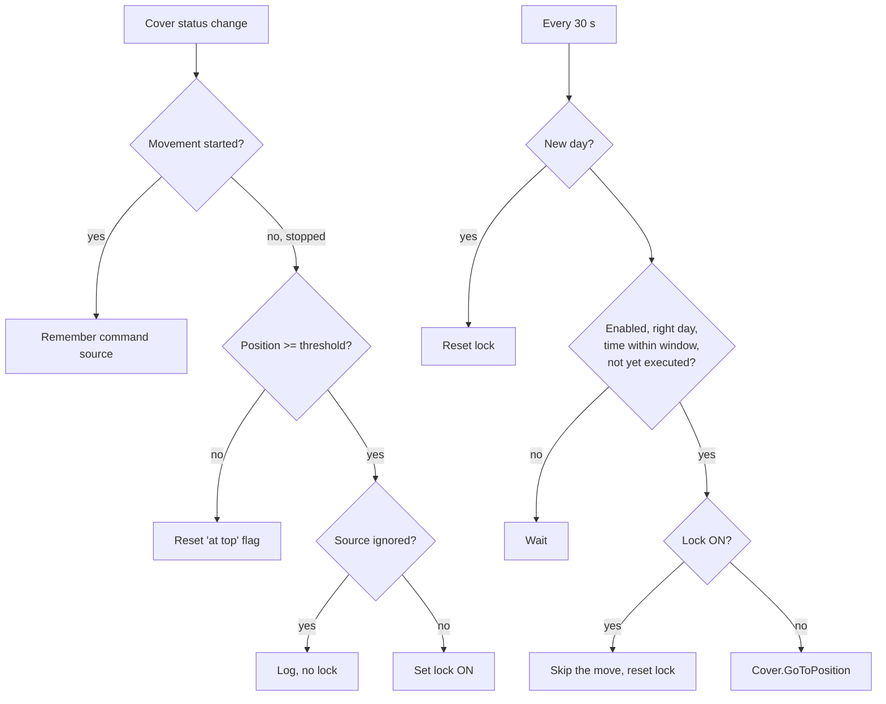

# Shelly Cover Manual Override

**English** | [Polski](README.pl.md) · [← All scripts](../README.md)

A Shelly script that moves a cover (roller shutter, blind) to a target position at a scheduled time — **unless someone opened it fully by hand earlier that day**. All settings are exposed as Virtual Components, so the end user can change them in the Shelly app or the device web UI without touching code. Runs locally on the device, no cloud required.

## The problem

A typical schedule: *"every Wednesday and Thursday at 15:00 set the blinds to 20%"*. If the user has opened the blinds fully before 15:00 (because they want the light), a plain scene still lowers them at 15:00.

Solutions built from several cloud scenes (one disabling the schedule when the cover is open, another re-enabling it) work, but they:

- block the schedule regardless of the time of day (opening the blinds on Wednesday evening also cancels Thursday's run),
- cannot tell a manual opening from an automatic one (a morning scene that opens to 100% blocks the afternoon run permanently),
- depend on the cloud and require several scenes to maintain one function.

This script solves all three.

## Features

- Scheduled move to a target position (time + days of week), configured from the app.
- Lock set automatically when the cover is opened fully **manually** (wall switch, remote, etc.).
- Command source filtering — automatic openings (from this script or chosen automations) do not set the lock.
- Lock is consumed by the skipped run and reset at midnight, so it affects only the current day.
- Lock visible and resettable by the user from the app.
- Grace window — a run missed because of a short reboot is still executed within a few minutes.
- Optional event log stored in a Virtual Component, visible in the app even when the script console is not open.
- Log messages in English or Polish.

## Requirements

- Shelly device with **Virtual Components** and scripting support — Gen3/Gen4 (e.g. Shelly 2PM Gen3) or the Pro series. Gen2 devices (e.g. Plus 2PM) have no Virtual Components.
- Device in **Cover** mode with a **calibrated** position.
- Correct **time zone** and synchronized time (SNTP).
- Tested on Shelly 2PM Gen3, firmware 2.0.1.

## How it works

The source of the movement is remembered when the cover **starts** moving, because when it reaches the end stop the firmware reports the source as `limit_switch`.

## Installation

### 1. Prepare the device

1. Update the firmware.
2. Make sure the device works in **Cover** mode and run the **calibration**.
3. In the time settings set the correct time zone and check that time is synchronized.
4. Disable any existing scenes/schedules controlling the same cover at the same time, so they do not conflict with the script.

### 2. Create Virtual Components

In the device web UI go to **Components → User-defined components → Create new**. IDs are assigned automatically from 200, separately for each type — create the components in this order and the IDs will match the script:

| Type | Expected ID | Name (suggested) | Settings | Default |
|---|---|---|---|---|
| Boolean | `boolean:200` | Automation enabled | View: Toggle | On |
| Boolean | `boolean:201` | Manual-open lock | View: Toggle | Off |
| Number | `number:200` | Target position | Min 0, Max 100, Step 1, Unit % | 20 |
| Number | `number:201` | Open threshold | Min 0, Max 100, Step 1, Unit % | 100 |
| Text | `text:200` | Execution time | View: Field, max length 5 | 15:00 |
| Text | `text:201` | Days of week | View: Field, max length 7 | 34 |
| Text *(optional)* | `text:202` | Recent events | View: Field, max length 255 | *(empty)* |

> **Use Boolean, not Button**, for the two switches. A Button has no state and the script will stop with a "component not found" error.

For every component set **Persisted** to the option that **keeps the last value after reboot**. Otherwise a power cut resets the user's settings to the defaults.

If any component gets a different ID (for example because one existed before), adjust `CFG.ids` at the top of the script.

### 3. Group the components

Create a group (e.g. "Cover schedule") and assign all components to it. Without a group the components are not shown on the device main page or in the app. Six components + the log + one group = 8 of the 10 available slots.

### 4. Install the script

1. Go to **Scripts → Create script**, name it e.g. `cover-manual-override`.
2. Paste the contents of [`cover-manual-override.js`](cover-manual-override.js).
3. Optionally set `lang: "pl"` in `CFG`.
4. **Save**, then **Start**, and enable **Run on startup**.
5. With the console open, a line `Start OK - ...` should appear, showing the current time, the weekday (1 = Monday) and the parameters.

## Configuration

### User parameters (Virtual Components)

| Parameter | Meaning |
|---|---|
| Automation enabled | Turns the whole function on or off. |
| Manual-open lock | ON = the next scheduled run today will be skipped. Set by the script, can be switched off by the user. |
| Target position | Position (0–100%) the cover moves to at the set time. |
| Open threshold | Position from which the cover counts as "fully open". Use 98–99 if your cover reports 99% at the top. |
| Execution time | `HH:MM`, 24-hour format, e.g. `15:00`. |
| Days of week | Digits of the days: `1`=Mon … `7`=Sun, e.g. `12345` = working days, `34` = Wed and Thu. Empty = every day. |
| Recent events | Read-only log: newest entries first, up to ~250 characters. |

### Script options (`CFG`)

| Option | Default | Meaning |
|---|---|---|
| `coverId` | `0` | Cover channel controlled by the script. |
| `ids` | see table above | IDs of the Virtual Components. |
| `ignoredSources` | `["loopback"]` | Command sources that never set the lock. `loopback` = this script. |
| `graceMin` | `5` | Minutes after the set time during which a missed run can still execute. |
| `tickMs` | `30000` | Schedule check interval (ms). |
| `lang` | `"en"` | Log language: `"en"` or `"pl"`. |
| `debug` | `true` | Print messages to the script console. |

### Command sources

Every time the cover reaches the threshold, the log shows the source of the command, e.g. `Lock ON (manual opening, source: ...)`. To decide which openings count as "manual":

1. Open the cover fully with each method you use: wall switch, BLU remote, app, other automation.
2. Note the source shown in the log for each.
3. Add the sources of **automatic** openings to `ignoredSources`, save and restart the script.

Note: if the app and a cloud scene report the same source, they cannot be distinguished — decide whether opening from the app should count as manual.

## Daily use

- Nothing to do: the cover moves to the target position on the selected days.
- Open the blinds fully by hand → that day's run is skipped. The **Manual-open lock** switch shows ON.
- Changed your mind? Switch the lock OFF and the run will happen as scheduled.
- Want a break from the automation? Switch **Automation enabled** OFF.
- The lock always resets at midnight, so an evening opening does not affect the next day.

## Testing

Before testing, set **Days of week** to empty and the **Execution time** to the current time + 2 minutes (the script checks every 30 s, so the action may come up to 30 s late).

| Test | Steps | Expected result |
|---|---|---|
| Normal run | Cover at ~50%, wait | `Executed: position 20%`, cover moves |
| Repeat after time change | Set a new time +2 min | Runs again without restarting the script |
| Lock | Open fully with the wall switch | `Lock ON (...)`, lock switch ON |
| Skip | With the lock ON, set time +2 min | `Skipped - ...`, cover stays up, lock OFF |
| Disabled | Automation OFF, time +2 min | Nothing happens |
| Days filter | Days without today's digit | Nothing happens |
| Reboot | Change parameters, reboot the device | Script starts by itself, `Start OK` shows the changed values |

After testing restore the target time and days.

## Troubleshooting

- **Script stops right after start with "component not found"** — a component is missing, has a different ID or the wrong type (Button instead of Boolean). Compare the component list with `CFG.ids`.
- **Console shows nothing, not even `print("test")`** — the web UI lost its WebSocket connection. Refresh the page (Ctrl+F5), close other tabs with the same device, check that browser tab sleeping is not suspending the page. The `text:202` event log does not depend on the console.
- **Lock never turns on** — the cover at the top reports less than the threshold (e.g. 99%). Lower the **Open threshold**.
- **Nothing happens at the set time** — check the time format (`15:00`), the days field (today's digit or empty), the automation switch, and time synchronization (the `Start OK` line shows the device time and weekday).
- **The cover does not stop exactly at the target position** — repeat the calibration.

## Limitations

- One script controls one cover channel (`coverId`). For more covers, run copies of the script with separate Virtual Components.
- A time close to midnight combined with `graceMin` does not wrap past midnight.
- Command sources that arrive the same way (e.g. app and cloud scenes) cannot be told apart.
- The number of Virtual Components and groups per device is limited (10 on Shelly 2PM Gen3).

## License

[MIT](../LICENSE) — free to use, modify and distribute, including commercially. Provided "as is", without warranty.

This is a community script and is not an official Shelly product. Shelly is a trademark of its respective owner.
