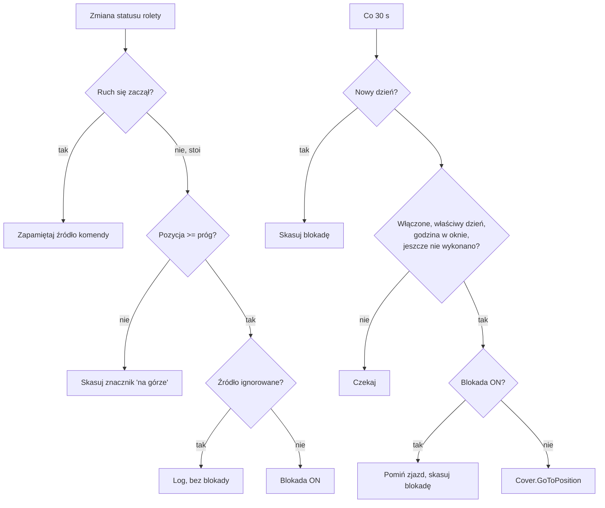

# Shelly Cover Manual Override

[English](README.md) | **Polski** · [← Wszystkie skrypty](../README.pl.md)

Skrypt Shelly, który o zadanej godzinie ustawia roletę (żaluzję, markizę) w zadanej pozycji — **chyba że ktoś wcześniej tego dnia ręcznie otworzył ją do końca**. Wszystkie ustawienia są dostępne jako Virtual Components, więc użytkownik zmienia je w aplikacji Shelly albo w web UI urządzenia, bez edycji kodu. Działa lokalnie na urządzeniu, bez chmury.

## Problem

Typowy harmonogram: *„w środy i czwartki o 15:00 ustaw rolety na 20%”*. Jeśli użytkownik przed 15:00 otworzy rolety do końca (bo chce mieć więcej światła), zwykła scena i tak zjedzie nimi do 20%.

Rozwiązania z kilku scen w chmurze (jedna wyłącza harmonogram, gdy roleta jest otwarta, druga włącza go z powrotem) działają, ale:

- blokują harmonogram niezależnie od pory dnia (otwarcie rolet w środę wieczorem blokuje też czwartkowy zjazd),
- nie odróżniają otwarcia ręcznego od automatycznego (poranna scena otwierająca na 100% blokuje popołudniowy zjazd na stałe),
- zależą od chmury i wymagają utrzymywania kilku scen dla jednej funkcji.

Ten skrypt rozwiązuje wszystkie trzy problemy.

## Funkcje

- Zjazd do zadanej pozycji według harmonogramu (godzina + dni tygodnia), ustawianego z aplikacji.
- Blokada ustawiana automatycznie, gdy roleta zostanie otwarta do końca **ręcznie** (przycisk ścienny, pilot itp.).
- Filtrowanie źródeł komend — otwarcia automatyczne (z tego skryptu albo wskazanych automatyzacji) nie ustawiają blokady.
- Blokada zużywa się przy pominiętym zjeździe i kasuje o północy, więc dotyczy tylko bieżącego dnia.
- Blokada jest widoczna w aplikacji i użytkownik może ją skasować.
- Okno tolerancji — zjazd pominięty przez krótki restart wykona się jeszcze w ciągu kilku minut.
- Opcjonalny dziennik zdarzeń w komponencie wirtualnym, widoczny w aplikacji nawet bez otwartej konsoli skryptu.
- Komunikaty po polsku lub po angielsku.

## Wymagania

- Urządzenie Shelly z obsługą **Virtual Components** i skryptów — Gen3/Gen4 (np. Shelly 2PM Gen3) albo seria Pro. Urządzenia Gen2 (np. Plus 2PM) nie mają Virtual Components.
- Urządzenie w trybie **Cover** ze **skalibrowaną** pozycją.
- Poprawna **strefa czasowa** i zsynchronizowany czas (SNTP).
- Przetestowano na Shelly 2PM Gen3, firmware 2.0.1.

## Jak to działa

Źródło ruchu jest zapamiętywane w momencie **startu** rolety, bo po dojechaniu do krańcówki firmware zgłasza źródło jako `limit_switch`.

## Instalacja

### 1. Przygotuj urządzenie

1. Zaktualizuj firmware.
2. Sprawdź, czy urządzenie pracuje w trybie **Cover**, i wykonaj **kalibrację**.
3. W ustawieniach czasu ustaw właściwą strefę czasową i upewnij się, że czas jest zsynchronizowany.
4. Wyłącz istniejące sceny i harmonogramy sterujące tą samą roletą o tej samej porze, żeby nie kolidowały ze skryptem.

### 2. Utwórz Virtual Components

W web UI urządzenia wejdź w **Components → User-defined components → Create new**. ID są nadawane automatycznie od 200, osobno dla każdego typu — twórz komponenty w tej kolejności, a ID zgodzą się ze skryptem:

| Typ | Oczekiwane ID | Nazwa (propozycja) | Ustawienia | Wartość domyślna |
|---|---|---|---|---|
| Boolean | `boolean:200` | Automatyka rolet | View: Toggle | On |
| Boolean | `boolean:201` | Blokada – ręczne otwarcie | View: Toggle | Off |
| Number | `number:200` | Pozycja docelowa | Min 0, Max 100, Step 1, Unit % | 20 |
| Number | `number:201` | Próg otwarcia | Min 0, Max 100, Step 1, Unit % | 100 |
| Text | `text:200` | Godzina wykonania | View: Field, max length 5 | 15:00 |
| Text | `text:201` | Dni tygodnia | View: Field, max length 7 | 34 |
| Text *(opcjonalnie)* | `text:202` | Ostatnie zdarzenia | View: Field, max length 255 | *(puste)* |

> **Dla obu przełączników użyj typu Boolean, nie Button.** Button nie przechowuje stanu i skrypt zatrzyma się z błędem „brak komponentu”.

W każdym komponencie ustaw **Persisted** na opcję **zachowującą ostatnią wartość po restarcie**. W przeciwnym razie zanik zasilania przywróci wartości domyślne zamiast ustawień użytkownika.

Jeśli któryś komponent dostanie inne ID (np. bo wcześniej istniał inny), popraw `CFG.ids` na początku skryptu.

### 3. Zgrupuj komponenty

Utwórz grupę (np. „Ustawienia rolet”) i przypisz do niej wszystkie komponenty. Bez grupy nie pojawią się na stronie głównej urządzenia ani w aplikacji. Sześć komponentów + dziennik + grupa = 8 z 10 dostępnych miejsc.

### 4. Wgraj skrypt

1. Wejdź w **Scripts → Create script** i nadaj nazwę, np. `cover-manual-override`.
2. Wklej zawartość pliku [`cover-manual-override.js`](cover-manual-override.js).
3. W `CFG` ustaw `lang: "pl"`, żeby komunikaty były po polsku.
4. Kliknij **Save**, potem **Start** i włącz **Run on startup**.
5. Przy otwartej konsoli powinna pojawić się linia `Start OK – ...` z aktualną godziną, dniem tygodnia (1 = poniedziałek) i parametrami.

## Konfiguracja

### Parametry użytkownika (Virtual Components)

| Parametr | Znaczenie |
|---|---|
| Automatyka rolet | Włącza lub wyłącza całą funkcję. |
| Blokada – ręczne otwarcie | ON = najbliższy dzisiejszy zjazd zostanie pominięty. Ustawiana przez skrypt, użytkownik może ją wyłączyć. |
| Pozycja docelowa | Pozycja (0–100%), do której roleta zjeżdża o zadanej godzinie. |
| Próg otwarcia | Pozycja, od której roleta jest uznawana za „otwartą do końca”. Ustaw 98–99, jeśli na górze roleta zgłasza 99%. |
| Godzina wykonania | `GG:MM`, format 24-godzinny, np. `15:00`. |
| Dni tygodnia | Cyfry dni: `1`=Pn … `7`=Nd, np. `12345` = dni robocze, `34` = śr i czw. Puste = codziennie. |
| Ostatnie zdarzenia | Dziennik tylko do odczytu: najnowsze wpisy na początku, do ok. 250 znaków. |

### Opcje skryptu (`CFG`)

| Opcja | Domyślnie | Znaczenie |
|---|---|---|
| `coverId` | `0` | Kanał rolety sterowany przez skrypt. |
| `ids` | jak w tabeli wyżej | ID komponentów wirtualnych. |
| `ignoredSources` | `["loopback"]` | Źródła komend, które nigdy nie ustawiają blokady. `loopback` = ten skrypt. |
| `graceMin` | `5` | Liczba minut po zadanej godzinie, w których pominięty zjazd może się jeszcze wykonać. |
| `tickMs` | `30000` | Co ile milisekund skrypt sprawdza harmonogram. |
| `lang` | `"en"` | Język komunikatów: `"en"` lub `"pl"`. |
| `debug` | `true` | Wypisywanie komunikatów w konsoli skryptu. |

### Źródła komend

Za każdym razem, gdy roleta dojedzie do progu, w dzienniku pojawia się źródło komendy, np. `Blokada ON (ręczne otwarcie, źródło: ...)`. Żeby ustalić, które otwarcia liczą się jako ręczne:

1. Otwórz roletę do końca każdym sposobem, którego używasz: przyciskiem ściennym, pilotem BLU, z aplikacji, inną automatyzacją.
2. Zanotuj źródło wyświetlone w dzienniku dla każdego z nich.
3. Źródła otwarć **automatycznych** dopisz do `ignoredSources`, zapisz i zrestartuj skrypt.

Uwaga: jeśli aplikacja i scena w chmurze zgłaszają to samo źródło, nie da się ich rozróżnić — trzeba zdecydować, czy otwarcie z aplikacji ma się liczyć jako ręczne.

## Codzienna obsługa

- Nic nie trzeba robić: w wybrane dni roleta zjedzie do zadanej pozycji.
- Otworzysz rolety ręcznie do końca → dzisiejszy zjazd zostanie pominięty. Przełącznik **Blokada – ręczne otwarcie** pokazuje ON.
- Zmiana decyzji? Wyłącz blokadę, a zjazd wykona się zgodnie z harmonogramem.
- Przerwa w automatyce? Wyłącz **Automatykę rolet**.
- Blokada zawsze kasuje się o północy, więc wieczorne otwarcie nie wpływa na następny dzień.

## Testy

Przed testami ustaw **Dni tygodnia** na puste, a **Godzinę wykonania** na aktualną + 2 minuty (skrypt sprawdza czas co 30 s, więc akcja może nastąpić do 30 s później).

| Test | Kroki | Oczekiwany wynik |
|---|---|---|
| Normalny zjazd | Roleta na ok. 50%, czekaj | `Wykonano: pozycja 20%`, roleta zjeżdża |
| Ponowne wykonanie | Ustaw nową godzinę +2 min | Wykonuje się ponownie bez restartu skryptu |
| Blokada | Otwórz do końca przyciskiem ściennym | `Blokada ON (...)`, przełącznik blokady ON |
| Pominięcie | Przy blokadzie ON ustaw godzinę +2 min | `Pomijam – ...`, roleta zostaje na górze, blokada OFF |
| Automatyka wyłączona | Automatyka OFF, godzina +2 min | Nic się nie dzieje |
| Filtr dni | Dni bez dzisiejszej cyfry | Nic się nie dzieje |
| Restart | Zmień parametry, zrestartuj urządzenie | Skrypt startuje sam, `Start OK` pokazuje zmienione wartości |

Po testach przywróć docelową godzinę i dni.

## Rozwiązywanie problemów

- **Skrypt zatrzymuje się zaraz po starcie z komunikatem „brak komponentu”** — brakuje komponentu, ma inne ID albo zły typ (Button zamiast Boolean). Porównaj listę komponentów z `CFG.ids`.
- **Konsola nic nie pokazuje, nawet `print("test")`** — web UI zgubił połączenie WebSocket. Odśwież stronę (Ctrl+F5), zamknij inne karty z tym samym urządzeniem, sprawdź, czy przeglądarka nie usypia karty. Dziennik w `text:202` nie zależy od konsoli.
- **Blokada nigdy się nie włącza** — roleta na górze zgłasza mniej niż próg (np. 99%). Obniż **Próg otwarcia**.
- **Nic się nie dzieje o zadanej godzinie** — sprawdź format godziny (`15:00`), pole dni (dzisiejsza cyfra albo puste), przełącznik automatyki i synchronizację czasu (linia `Start OK` pokazuje czas i dzień tygodnia urządzenia).
- **Roleta nie trafia dokładnie w pozycję** — powtórz kalibrację.

## Ograniczenia

- Jeden skrypt steruje jednym kanałem rolety (`coverId`). Przy kilku roletach uruchom kopie skryptu z osobnymi komponentami wirtualnymi.
- Godzina bliska północy w połączeniu z `graceMin` nie przechodzi na następny dzień.
- Źródeł komend docierających tą samą drogą (np. aplikacja i sceny w chmurze) nie da się rozróżnić.
- Liczba komponentów wirtualnych i grup na urządzeniu jest ograniczona (10 na Shelly 2PM Gen3).

## Licencja

[MIT](../LICENSE) — możesz swobodnie używać, modyfikować i rozpowszechniać, także komercyjnie. Bez gwarancji, „tak jak jest”.

To skrypt społecznościowy, a nie oficjalny produkt Shelly. Shelly jest znakiem towarowym swojego właściciela.
