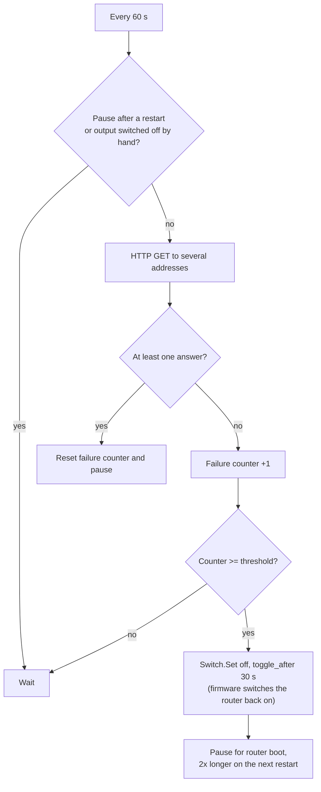

# Shelly Router Watchdog

**English** | [Polski](README.pl.md) · [← All scripts](../README.md)

A Shelly script that **automatically restarts a hung router or modem**. The plug (or relay) powering the router checks every minute whether the Internet is reachable. If it is not for a few minutes, it cuts power to the router for 30 s and switches it back on. It runs locally on the device, so it works exactly when the Internet and the cloud are down.

## Problem

A classic: the router hangs, the Internet is gone and only "turn it off and on again" helps. A Shelly plug under the router looks like the perfect fix, but controlling it from the app will not work, because **the hung router also cuts off communication with the plug**. A cloud scene will not run either.

The solution is a script running on the plug itself: the device decides about the restart, without the cloud.

## Features

- Internet check with HTTP requests to several addresses — one answer is enough, so a single unavailable service does not trigger a restart. Detects both a dead Wi-Fi and a router that has Wi-Fi but no Internet.
- Restart only after several failed checks in a row (5 by default, i.e. about 5 minutes).
- **The firmware, not the script, switches the router back on** (`toggle_after`), so the router comes back even if the script is stopped in the meantime.
- **Growing pauses between restarts** (5 → 10 → 20 → 40 → 60 min). When the outage is on the ISP side, the router is not power-cycled forever.
- Start delay, so the router has time to boot after a power outage.
- Switching the router off by hand (button, app) pauses the checks — the script does not fight the user.
- Log messages in English or Polish.

## Requirements

- A Shelly **Gen2 or newer** device with scripting, e.g. Shelly Plus Plug S, Plug S Gen3, Outdoor Plug S, Plus 1, 1 Gen3. **Gen1** devices (e.g. Shelly Plug S Gen1) have no scripting.
- Virtual Components are **not** needed — the script also runs on Gen2.
- The plug is connected to the Wi-Fi of the router it watches (the usual case).

## How it works

## Installation

### 1. Prepare the device

1. Update the firmware.
2. In the output settings set **Power on default** to **ON**. After a power outage the router must always come up, regardless of its previous state.
3. Disable **Auto OFF / Auto ON** and schedules controlling this output.
4. Recommended: lock the physical button on the plug or tell the household what it is for.

### 2. Upload the script

1. Open the device web UI (its IP address in a browser) and go to **Scripts → Create script**, name e.g. `router-watchdog`.
2. Paste the contents of [`router-watchdog.js`](router-watchdog.js).
3. Click **Save**, then **Start** and enable **Run on startup**.
4. With the console open you will see `Start OK - ...`. The first check runs after `startDelay` (2 min by default).

## Configuration (`CFG`)

| Option | Default | Meaning |
|---|---|---|
| `switchId` | `0` | Output channel powering the router. |
| `endpoints` | 3 addresses | Addresses checked in each cycle. One valid answer (2xx/3xx) is enough. `1.1.1.1` needs no DNS, so it also catches a DNS-only failure. |
| `httpTimeout` | `10` | Timeout of a single request [s]. |
| `checkEvery` | `60` | Check interval [s]. |
| `failThreshold` | `5` | Failed checks in a row that trigger a restart. Time to restart ≈ `checkEvery × failThreshold`. |
| `offTime` | `30` | How long the router stays off [s]. |
| `startDelay` | `120` | Delay of the first check after the script starts [s]. |
| `bootGrace` | `300` | Pause after the first restart for the router to boot [s]. For slow routers (e.g. LTE/5G) increase to 600. |
| `maxBackoff` | `3600` | Longest pause between consecutive restarts [s]. |
| `respectManualOff` | `true` | While the output is switched off by hand, the script does not check and does nothing. |
| `lang` | `"en"` | Log language: `"en"` or `"pl"`. |
| `debug` | `true` | Print messages to the script console. |

Use **HTTP** addresses, not HTTPS: HTTPS requests use much more device memory. Addresses should return a short response (like `generate_204`).

## Testing

1. **Normal operation** — with working Internet, the console shows no failures after start.
2. **Restart** — unplug the WAN cable from the router (Internet gone, Wi-Fi stays). After about 5 min: `No Internet - failure 5/5`, `Restarting router ...`, the router goes off for 30 s and comes back by itself.
3. **Internet back** — plug the WAN back in. After the pause: `Internet is back ...`.
4. **Pauses** — with WAN unplugged, watch consecutive restarts: the intervals should grow.
5. **Manual off** — switch the output off from the app or button: `Output is OFF (switched off manually) - checks paused`, the script does not switch it on.

For faster tests, temporarily lower `failThreshold` and `bootGrace`.

## Troubleshooting

- **The router restarts although the Internet works** — check the plug's Wi-Fi signal (a weak signal causes failed requests). Increase `failThreshold` or `httpTimeout`. Check that the network does not block the addresses used.
- **The router does not come back after a restart** — check that the output has no Auto OFF and no scene switches it off.
- **The script does not run after a power outage** — enable **Run on startup**.
- **The script stops with "switch:0 not found"** — the device uses another channel; fix `switchId`.

## Limitations

- The script only helps when the router itself hangs. During an ISP outage restarts do not help — that is why the pauses between them grow.
- During a long pause after several restarts (up to 1 h), a new hang is detected only when the pause ends.
- The plug must be connected to the router it restarts — if it uses another network, it checks the wrong Internet connection.

## License

[MIT](../LICENSE) — free to use, modify and distribute, including commercially. Provided "as is", without warranty.

This is a community script, not an official Shelly product. The idea is based on the "Router Watchdog" example from the Shelly script library. Shelly is a trademark of its respective owner.
