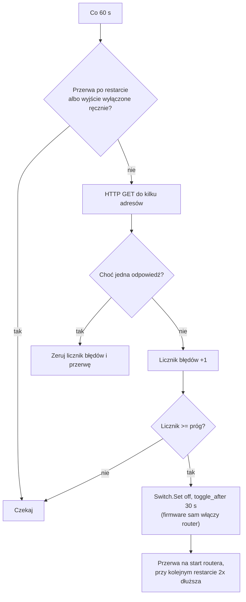

# Shelly Router Watchdog

[English](README.md) | **Polski** · [← Wszystkie skrypty](../README.pl.md)

Skrypt Shelly, który **automatycznie restartuje zawieszony router lub modem**. Plug (albo przekaźnik) zasilający router co minutę sprawdza, czy jest internet. Jeśli internetu nie ma przez kilka minut, wyłącza zasilanie routera na 30 s i włącza je z powrotem. Działa lokalnie na urządzeniu, więc działa właśnie wtedy, gdy internetu i chmury nie ma.

## Problem

Klasyka: router się zawiesza, internet znika i pomaga tylko „wyłącz i włącz”. Plug Shelly pod routerem wydaje się idealnym rozwiązaniem, ale sterowanie nim z aplikacji nie zadziała, bo **zawieszony router odcina też komunikację z plugiem**. Scena w chmurze też się nie wykona.

Rozwiązaniem jest skrypt działający na samym plugu: decyzję o restarcie podejmuje urządzenie, bez udziału chmury.

## Funkcje

- Sprawdzanie internetu zapytaniami HTTP do kilku adresów — wystarczy jedna odpowiedź, więc chwilowa niedostępność jednego serwisu nie wywoła restartu. Wykrywa zarówno padnięte Wi-Fi, jak i router, który ma Wi-Fi, ale nie ma internetu.
- Restart dopiero po kilku nieudanych sprawdzeniach z rzędu (domyślnie 5, czyli ok. 5 minut).
- **Ponowne włączenie robi firmware, nie skrypt** (`toggle_after`), więc router wróci, nawet jeśli skrypt zostanie w międzyczasie zatrzymany.
- **Rosnące przerwy między restartami** (5 → 10 → 20 → 40 → 60 min). Gdy awaria jest po stronie operatora, router nie jest restartowany w nieskończoność.
- Opóźnienie po starcie, żeby po zaniku prądu router zdążył się uruchomić.
- Ręczne wyłączenie routera (przycisk, aplikacja) wstrzymuje sprawdzanie — skrypt nie walczy z użytkownikiem.
- Komunikaty po polsku lub po angielsku.

## Wymagania

- Urządzenie Shelly **Gen2 lub nowsze** ze skryptami, np. Shelly Plus Plug S, Plug S Gen3, Outdoor Plug S, Plus 1, 1 Gen3. Urządzenia **Gen1** (np. Shelly Plug S Gen1) nie obsługują skryptów.
- Virtual Components **nie** są potrzebne — skrypt działa także na Gen2.
- Plug połączony z Wi-Fi routera, który nadzoruje (tak jest zwykle).

## Jak to działa

## Instalacja

### 1. Przygotuj urządzenie

1. Zaktualizuj firmware.
2. W ustawieniach wyjścia ustaw **Power on default / Stan po włączeniu zasilania** na **ON**. Po zaniku prądu router zawsze ma wstać, niezależnie od stanu sprzed awarii.
3. Wyłącz **Auto OFF / Auto ON** i harmonogramy, które sterują tym wyjściem.
4. Zalecane: zablokuj fizyczny przycisk na plugu albo poinformuj domowników, do czego służy.

### 2. Wgraj skrypt

1. Otwórz web UI urządzenia (jego adres IP w przeglądarce) i wejdź w **Scripts → Create script**, nazwa np. `router-watchdog`.
2. Wklej zawartość pliku [`router-watchdog.js`](router-watchdog.js).
3. W `CFG` ustaw `lang: "pl"`, żeby komunikaty były po polsku.
4. Kliknij **Save**, potem **Start** i włącz **Run on startup**.
5. Przy otwartej konsoli pojawi się linia `Start OK – ...`. Pierwsze sprawdzenie nastąpi po `startDelay` (domyślnie 2 min).

## Konfiguracja (`CFG`)

| Opcja | Domyślnie | Znaczenie |
|---|---|---|
| `switchId` | `0` | Kanał wyjścia zasilającego router. |
| `endpoints` | 3 adresy | Adresy sprawdzane co cykl. Wystarczy jedna poprawna odpowiedź (kod 2xx/3xx). `1.1.1.1` nie wymaga DNS, więc wykrywa też awarię samego DNS. |
| `httpTimeout` | `10` | Limit czasu pojedynczego zapytania [s]. |
| `checkEvery` | `60` | Co ile sekund sprawdzać internet. |
| `failThreshold` | `5` | Ile nieudanych sprawdzeń z rzędu wywołuje restart. Czas do restartu ≈ `checkEvery × failThreshold`. |
| `offTime` | `30` | Na ile sekund wyłączyć router. |
| `startDelay` | `120` | Opóźnienie pierwszego sprawdzenia po starcie skryptu [s]. |
| `bootGrace` | `300` | Przerwa po pierwszym restarcie na uruchomienie routera [s]. Przy wolnych routerach (np. LTE/5G) zwiększ do 600. |
| `maxBackoff` | `3600` | Najdłuższa przerwa między kolejnymi restartami [s]. |
| `respectManualOff` | `true` | Gdy wyjście jest wyłączone ręcznie, skrypt nie sprawdza internetu i nic nie robi. |
| `lang` | `"en"` | Język komunikatów: `"en"` lub `"pl"`. |
| `debug` | `true` | Wypisywanie komunikatów w konsoli skryptu. |

Używaj adresów **HTTP**, nie HTTPS: zapytania HTTPS zużywają znacznie więcej pamięci urządzenia. Adresy powinny zwracać krótką odpowiedź (jak `generate_204`).

## Testy

1. **Normalna praca** — przy działającym internecie konsola po starcie nie pokazuje błędów.
2. **Restart** — odłącz kabel WAN od routera (internet znika, Wi-Fi zostaje). Po ok. 5 min: `Brak internetu – błąd 5/5`, `Restart routera ...`, router gaśnie na 30 s i wraca sam.
3. **Powrót internetu** — podłącz WAN. Po zakończeniu przerwy: `Internet wrócił ...`.
4. **Przerwy** — przy odłączonym WAN obserwuj kolejne restarty: odstępy powinny rosnąć.
5. **Ręczne wyłączenie** — wyłącz wyjście z aplikacji lub przycisku: `Wyjście wyłączone ręcznie – sprawdzanie wstrzymane`, skrypt go nie włącza.

Do szybszych testów tymczasowo zmniejsz `failThreshold` i `bootGrace`.

## Rozwiązywanie problemów

- **Router restartuje się mimo działającego internetu** — sprawdź, czy plug ma dobry zasięg Wi-Fi (słaby sygnał daje nieudane zapytania). Zwiększ `failThreshold` albo `httpTimeout`. Sprawdź, czy sieć klienta nie blokuje użytych adresów.
- **Router nie wraca po restarcie** — sprawdź, czy wyjście nie ma ustawionego Auto OFF i czy żadna scena go nie wyłącza.
- **Skrypt nie działa po zaniku prądu** — włącz **Run on startup**.
- **Skrypt zatrzymuje się z błędem „brak switch:0”** — urządzenie ma inny kanał; popraw `switchId`.

## Ograniczenia

- Skrypt pomaga tylko wtedy, gdy przyczyną jest zawieszony router. Przy awarii po stronie operatora restarty nic nie dadzą — dlatego przerwy między nimi rosną.
- W trakcie długiej przerwy po kilku restartach (do 1 h) kolejne zawieszenie zostanie wykryte dopiero po jej zakończeniu.
- Plug musi być podłączony do tego routera, który restartuje — jeśli korzysta z innej sieci (np. LTE z osobnym routerem), sprawdza nie ten internet.

## Licencja

[MIT](../LICENSE) — możesz swobodnie używać, modyfikować i rozpowszechniać, także komercyjnie. Bez gwarancji, „tak jak jest”.

To skrypt społecznościowy, a nie oficjalny produkt Shelly. Pomysł bazuje na przykładzie „Router Watchdog” z biblioteki skryptów Shelly. Shelly jest znakiem towarowym swojego właściciela.
